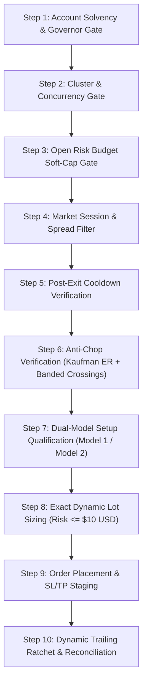

# STANDARDIZED TRADING DECISION CHAIN & INSTITUTIONAL EXECUTION PROTOCOL

> **GOVERNANCE DIRECTIVE**:
> Mandatory standardized 10-step institutional decision chain governing all algorithmic and discretionary operations for FundedNext MetaTrader 5 institutional accounts.
> Every autonomous turn, sweep, backtest, and manual intervention must strictly conform to these invariants.

---

## SECTION 1: ACCOUNT SOLVENCY, LIMITS & HARD GATES

### 1.1 Broker Account Ground Truth
- **Broker / Server**: FundedNext (`FundedNext-Server`)
- **Challenge Tier**: Evaluation Tier 1 ($5,000.00 USD)
- **Lifetime Static Floor**: **$4,500.00 USD** (Strict 10% maximum loss limit)
- **Daily Loss Limit**: **$250.00 USD** (Strict 5% daily limit)
- **Daily Throttle Limit**: **$200.00 USD** (80% threshold — halts new entries, manages existing)
- **Target Risk per Trade**: **$10.00 USD** (1.0R)
- **Hard Max Risk Cap per Trade**: **$11.00 USD** (1.1R maximum with slippage/commission buffer)
- **Global Concurrency Ceiling**: **4 concurrent open positions**
- **Sector / Cluster Isolation**: **Max 1 active position per cluster**

### 1.2 Broker Server Day & Offset Invariant
- Broker server runs on UTC+2 (Eastern European Time / EET) or UTC+3 (EEST summer).
- Server 00:00:00 midnight occurs at **22:00:00 UTC** (or 21:00:00 UTC in DST).
- `DailyRiskGovernor` anchors daily equity at 00:00 server time to `max(current_balance, current_equity)`.
- Loss used today is calculated strictly as `max(0.0, anchor_equity - current_equity)`. Realized losses are never double-counted.
- Anchor and server day states are persisted atomically to `audit/governor_state.json`.

---

## SECTION 2: THE 10-STEP STANDARDIZED DECISION CHAIN

### Step 1: Account Solvency & Daily Risk Governor Gate
- Verify MT5 connection and live account info.
- Verify equity > $4,500.00 USD floor. If equity <= $4,500.00, trigger `flatten_all("FLOOR_BREACH")` immediately.
- Verify loss used today < $250.00 USD. If breached, halt all new entries.
- If loss used today >= $200.00 USD (80%), halt new entries (throttle mode).

### Step 2: Global Concurrency & Cluster Isolation Gate
- Max concurrent positions across the entire portfolio: **4**.
- Max active positions in any single cluster: **1**.
- The 6 uncorrelated clusters:
  1. `Crypto` (DOGUSD, ETHUSD, ADAUSD, XLMUSD)
  2. `Commodity_Energy` (XAUUSD)
  3. `Indices` (US30, HK50)
  4. `Forex_JPY` (NZDJPY, CHFJPY, EURJPY, USDJPY, CADJPY)
  5. `Forex_USD` / `Forex_Exotic` (USDCHF, USDCNH, NZDSGD)
  6. `US_Equities` (MSFT, AMD, BABA, NFLX, NKE)

### Step 3: Open Risk Budget Soft-Cap Gate
- Compute `open_risk = sum(p["actual_risk_usd"] for p in active_positions)`.
- Enforce soft cap: `used_loss_today + open_risk + new_trade_risk <= 0.90 * daily_limit ($225.00)`.

### Step 4: Market Session & Spread Filter
- Verify symbol trade mode is `SYMBOL_TRADE_MODE_FULL`.
- Verify bid/ask ticks are valid and live.
- Check current spread against 14-period ATR; spread must be <= 0.35 ATR.

### Step 5: Post-Exit Cooldown Verification
- Enforce strict **12-bar post-exit cooldown** per asset (48 hours on 4H, 12 hours on 1H).
- Evaluated using broker server timestamp.

### Step 6: Anti-Chop & Regime Gates
- **Kaufman Efficiency Ratio (ER)**: 10-bar Kaufman ER must be >= **0.28**. If ER < 0.28, reject as noise.
- **ATR-Banded Crossings**: Count candle crossings across `EMA +- 0.25 * ATR` in last 12 bars. Must be < **2**.

### Step 7: Dual-Model Setup Qualification
- **Model 1: Pullback Rejection on Champion EMA**:
  - ATR-normalized EMA slope: `|slope| >= 0.02 ATR/bar` over lookback (4 bars on 1H, 3 bars on 4H).
  - Pullback Origin: Price was previously on trend side of EMA.
  - Rejection Wick: Pinbar wick >= **25%** of candle range into EMA shelf.
  - Decisive Clearance: Candle close must clear EMA by at least `0.05 * ATR`.
- **Model 2: Macro Dwell & Reclaim Spring**:
  - Rejection Wick: Pinbar wick >= **33%** of candle range.
  - Dwell Duration: Accumulated dwell bars beyond EMA (3–25 bars on 4H, 12–60 bars on 1H).
  - Decisive Clearance: Candle close must clear EMA by at least `max(0.12 * ATR, 1.5 * spread)`.

### Step 8: Dynamic Lot Sizing & Risk Hard Cap
- Exact target risk = **$10.00 USD**.
- Institutional Stop Loss = `1.5 * ATR(14)`.
- Lot calculation: `lot = target_risk / (risk_dist_points * tick_value_per_point)`.
- Lot clamped to broker `volume_min`, `volume_max`, `volume_step`.
- Stressed risk check: `order_calc_profit` must confirm calculated risk <= **$11.00 USD** (1.1R hard cap).

### Step 9: Atomic Order Placement & SL/TP Staging
- Send `TRADE_ACTION_DEAL` with broker-side SL and TP attached.
- If broker rejects order (e.g. market closed, retcode 10026), log to `manual_action_pending.json`.
- Strictly zero ticket fabrication and zero phantom state creation.

### Step 10: Dynamic Trailing Ratchet & Reconciliation
- Continuous 10-second tick loop monitors Maximum Favorable Excursion (MFE in R).
- Trailing Ratchets:
  - `trail_1.5r`: Once MFE >= 2.5R, trail SL at `MFE - 1.5R`.
  - `trail_1.0r`: Once MFE >= 2.0R, trail SL at `MFE - 1.0R`.
  - `trail_0.5r`: Once MFE >= 1.5R, trail SL at `MFE - 0.5R`.
  - `fixed_4.0r`: Fixed take profit at 4.0R.
  - `fixed_3.5r`: Fixed take profit at 3.5R.
- Send broker `TRADE_ACTION_SLTP` modification. If broker rejects, maintain virtual trailing stop.
- On exit, reconcile deal history via `mt5.history_deals_get(position=ticket)`, record net PnL (profit + commission + swap + fee), and trigger 12-bar cooldown.

---

## SECTION 3: 20-ASSET CHAMPION BASKET MATRIX

| Symbol | Cluster | Timeframe | Primary Model | Champion EMA | Exit Mode | Target Risk |
| :--- | :--- | :--- | :--- | :--- | :--- | :--- |
| **DOGUSD** | Crypto | 1H | MODEL_1 | 55 | `trail_1.0r` | $10.00 |
| **ETHUSD** | Crypto | 1H | MODEL_1 | 100 | `trail_1.5r` | $10.00 |
| **ADAUSD** | Crypto | 1H | MODEL_1 | 100 | `fixed_4.0r` | $10.00 |
| **XLMUSD** | Crypto | 1H | MODEL_1 | 233 | `trail_1.5r` | $10.00 |
| **XAUUSD** | Commodity_Energy | 4H | MODEL_1 | 50 | `trail_1.5r` | $10.00 |
| **US30** | Indices | 1H | MODEL_1 | 65 | `trail_1.0r` | $10.00 |
| **HK50** | Indices | 1H | MODEL_1 | 50 | `trail_0.5r` | $10.00 |
| **NZDJPY** | Forex_JPY | 1H | MODEL_1 | 65 | `fixed_3.5r` | $10.00 |
| **CHFJPY** | Forex_JPY | 4H | MODEL_2 | 50 | `trail_1.5r` | $10.00 |
| **EURJPY** | Forex_JPY | 1H | MODEL_1 | 277 | `trail_1.0r` | $10.00 |
| **USDJPY** | Forex_JPY | 1H | MODEL_1 | 50 | `trail_0.5r` | $10.00 |
| **CADJPY** | Forex_JPY | 1H | MODEL_2 | 55 | `trail_1.5r` | $10.00 |
| **USDCHF** | Forex_USD | 1H | MODEL_1 | 400 | `trail_0.5r` | $10.00 |
| **USDCNH** | Forex_USD | 1H | MODEL_2 | 160 | `fixed_4.0r` | $10.00 |
| **NZDSGD** | Forex_Exotic | 1H | MODEL_1 | 89 | `fixed_4.0r` | $10.00 |
| **MSFT** | US_Equities | 1H | MODEL_1 | 65 | `trail_1.5r` | $10.00 |
| **AMD** | US_Equities | 1H | MODEL_1 | 89 | `trail_1.0r` | $10.00 |
| **BABA** | US_Equities | 1H | MODEL_1 | 300 | `trail_1.0r` | $10.00 |
| **NFLX** | US_Equities | 1H | MODEL_1 | 65 | `trail_0.5r` | $10.00 |
| **NKE** | US_Equities | 1H | MODEL_1 | 75 | `trail_0.5r` | $10.00 |

---
*Certified & Integrated: November 2026 | Delta Fibonacci Institutional Architecture*
