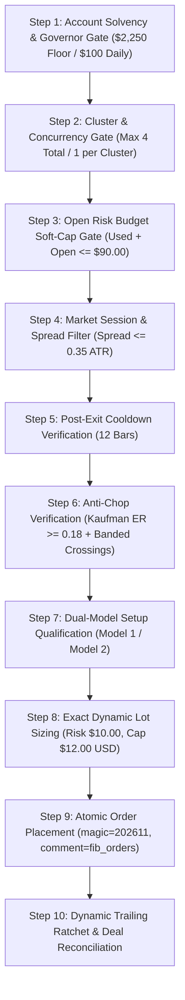

# STANDARDIZED TRADING DECISION CHAIN & INSTITUTIONAL EXECUTION PROTOCOL

> **GOVERNANCE DIRECTIVE**:
> Mandatory standardized 10-step institutional decision chain governing all algorithmic operations on **Blueberry Markets MT5 Account #5126976** (Blueberry Funded Prime 2-Step, $2,500 tier).
> Every autonomous turn, sweep, backtest, and manual intervention must strictly conform to these invariants.

---

## SECTION 1: ACCOUNT SOLVENCY, LIMITS & MULTI-ALGO ISOLATION

### 1.1 Broker Account Ground Truth
- **Broker / Server**: Blueberry Markets (`BlueberryMarketsSVG-Live`)
- **Account Login**: **`5126976`**
- **Challenge Tier**: Blueberry Funded Prime 2-Step ($2,500.00 USD starting balance)
- **Lifetime Static Floor**: **$2,250.00 USD** (Strict 10% maximum static loss limit, $250.00 buffer)
- **Daily Loss Limit**: **$100.00 USD** (Strict 4% daily limit measured from 00:00 server time)
- **Daily Throttle Limit**: **$80.00 USD** (80% threshold — halts new entries, manages existing)
- **Target Risk per Trade**: **$10.00 USD** (1.0R)
- **Hard Max Risk Cap per Trade**: **$12.00 USD** (1.2R maximum with slippage/commission buffer)
- **Order Identification**: **`comment="fib_orders"`** | **`magic=202611`**
- **Global Concurrency Ceiling**: **4 concurrent open fib_orders**
- **Sector / Cluster Isolation**: **Max 1 active fib_order per cluster**

### 1.2 Multi-Algorithm Coexistence Invariant
> [!IMPORTANT]
> **Strict EA Isolation Rule**: Other algorithmic strategies run simultaneously on this MT5 account.
> The Fibonacci engine is **exclusively responsible for orders carrying `comment="fib_orders"` or `magic=202611`**.
> It must NEVER track, modify, trail, or close positions opened by other algorithms on this account.

### 1.3 Broker Server Day & Offset Invariant
- Broker server runs on UTC+2 (Eastern European Time / EET) or UTC+3 (EEST summer).
- Server 00:00:00 midnight occurs at **22:00:00 UTC** (or 21:00:00 UTC in DST).
- `DailyRiskGovernor` anchors daily equity at 00:00 server time to `max(current_balance, current_equity)`.
- Loss used today is calculated strictly as `max(0.0, anchor_equity - current_equity)`. Realized losses are never double-counted.
- Anchor and server day states are persisted atomically to `audit/governor_state.json`.

---

## SECTION 2: THE 10-STEP STANDARDIZED DECISION CHAIN

### Step 1: Account Solvency & Daily Risk Governor Gate
- Verify MT5 connection to `BlueberryMarketsSVG-Live` (Login #5126976).
- Verify equity > $2,250.00 USD floor. If equity <= $2,250.00, trigger `flatten_all("FLOOR_BREACH")` immediately.
- Verify loss used today < $100.00 USD. If breached, halt all new entries.
- If loss used today >= $80.00 USD (80%), halt new entries (throttle mode).

### Step 2: Global Concurrency & Cluster Isolation Gate
- Max concurrent `fib_orders` across the entire portfolio: **4**.
- Max active `fib_orders` in any single cluster: **1**.
- Uncorrelated clusters: `Crypto`, `Commodity_Energy`, `Indices`, `Forex_Majors`, `Forex_JPY`, `Forex_Crosses_Exotics`.

### Step 3: Open Risk Budget Soft-Cap Gate
- Compute `open_risk = sum(p["actual_risk_usd"] for p in active_positions if p["comment"] == "fib_orders")`.
- Enforce soft cap: `used_loss_today + open_risk + new_trade_risk <= 0.90 * daily_limit ($90.00 USD)`.

### Step 4: Market Session & Spread Filter
- Verify symbol trade mode is `SYMBOL_TRADE_MODE_FULL`.
- Verify bid/ask ticks are valid and live.
- Check current spread against the 1R institutional risk distance (1.5 * ATR): spread must be <= **15% of 1R** (≈ 0.23 ATR).

### Step 5: Post-Exit Cooldown Verification
- Enforce strict **12-bar post-exit cooldown** per asset, counted in CLOSED bars after the exit bar (exact backtest parity; wall-clock hours are only an approximation on 24×5 markets and drift across weekends).
- Evaluated using broker server timestamp anchored to the candle series.

### Step 6: Anti-Chop & Regime Gates
- **Kaufman Efficiency Ratio (ER)**: 10-bar Kaufman ER must be >= **0.18**. If ER < 0.18, reject as noise unless exempted by strong rejection wick.
- **Rejection Wick Exemption**: Pinbar rejection wick >= **35%** into the champion EMA shelf exempts the setup from ER filter (institutional pinbar / rejection dynamic).
- **ATR-Banded Crossings**: Count candle crossings across `EMA +- 0.25 * ATR` in last 12 bars. Must be < **2**.

### Step 7: Dual-Model Setup Qualification
- **Model 1: Pullback Rejection on Champion EMA**:
  - ATR-normalized EMA slope: `|slope| >= 0.02 ATR/bar` over lookback (4 bars on 1H, 3 bars on 4H).
  - Pullback Origin: Price was previously on trend side of EMA.
  - Rejection Wick: Pinbar wick >= **25%** of candle range into EMA shelf.
  - Decisive Clearance: Candle close must clear EMA by at least `0.05 * ATR`.
- **Model 2: Macro Dwell & Reclaim Spring**:
  - Rejection Wick: Pinbar wick >= **33%** of candle range.
  - Dwell Duration: Accumulated dwell bars beyond EMA (3–25 bars on 4H, 12–60 bars on 1H).
  - Decisive Clearance: Candle close must clear EMA by at least `max(0.12 * ATR, 1.5 * spread)`.

### Step 8: Dynamic Lot Sizing & Risk Hard Cap
- Exact target risk = **$10.00 USD** (or broker `volume_min` lot size).
- Hard max risk cap = **$12.00 USD** (1.2R max).
- Institutional Stop Loss = `1.5 * ATR(14)`.
- Lot calculation: `lot = target_risk / (risk_dist_points * tick_value_per_point)`.
- Lot clamped to broker `volume_min`, `volume_max`, `volume_step`.
- Stressed risk check: calculated risk must be strictly <= **$12.00 USD**.

### Step 9: Atomic Order Placement & Multi-EA Tagging
- Send `TRADE_ACTION_DEAL` with `magic=202611`, `comment="fib_orders"`.
- If broker rejects order, log to `manual_action_pending.json`.
- Strictly zero ticket fabrication and zero phantom state creation.

### Step 10: Dynamic Trailing Ratchet & Reconciliation
- Continuous 10-second tick loop monitors Maximum Favorable Excursion (MFE in R).
- Backtest Parity Note: MT5_Backtest.py models intrabar sequencing with the candle-direction convention (bullish bar = low printed first, bearish bar = high printed first), so the stop governing each bar's adverse extreme is the one live would have had in force at that moment - no favorable-sequencing assumption on trailing exits.
- Trailing Ratchets:
  - `trail_1.5r`: Once MFE >= 2.5R, trail SL at `MFE - 1.5R`.
  - `trail_1.0r`: Once MFE >= 2.0R, trail SL at `MFE - 1.0R`.
  - `trail_0.5r`: Once MFE >= 1.5R, trail SL at `MFE - 0.5R`.
  - `fixed_4.0r`: Fixed take profit at 4.0R.
  - `fixed_3.5r`: Fixed take profit at 3.5R.
  - `fixed_2.5r`: Fixed take profit at 2.5R.
- Send broker `TRADE_ACTION_SLTP` modification. If broker rejects, maintain virtual trailing stop.
- On exit, reconcile deal history via `mt5.history_deals_get(position=ticket)`, record net PnL (profit + commission + swap + fee), and trigger 12-bar cooldown.

---

## SECTION 3: BLUEBERRY MARKETS 23-ASSET CHAMPION BASKET

| Symbol | Cluster | Timeframe | Primary Model | Champion EMA | Exit Mode | Target Risk | Hard Risk Cap |
| :--- | :--- | :---: | :---: | :---: | :--- | :---: | :---: |
| **SP500.p** | Indices | 1H | MODEL_1 | 89 | `trail_0.5r` | $10.00 | $12.00 |
| **JP225.p** | Indices | 1H | MODEL_1 | 65 | `trail_0.5r` | $10.00 | $12.00 |
| **DJ30.p** | Indices | 1H | MODEL_1 | 55 | `trail_0.5r` | $10.00 | $12.00 |
| **NAS100.p** | Indices | 1H | MODEL_1 | 55 | `trail_0.5r` | $10.00 | $12.00 |
| **HK50.p** | Indices | 1H | MODEL_1 | 50 | `trail_0.5r` | $10.00 | $12.00 |
| **XAUUSD.pi** | Commodity_Energy | 1H | MODEL_1 | 55 | `fixed_3.5r` | $10.00 | $12.00 |
| **XAGUSD.pi** | Commodity_Energy | 1H | MODEL_1 | 160 | `fixed_4.0r` | $10.00 | $12.00 |
| **USWTI.p** | Commodity_Energy | 1H | MODEL_1 | 50 | `trail_0.5r` | $10.00 | $12.00 |
| **BTCUSD.pi** | Crypto | 1H | MODEL_2 | 233 | `fixed_4.0r` | $10.00 | $12.00 |
| **ETHUSD.pi** | Crypto | 4H | MODEL_2 | 89 | `fixed_3.5r` | $10.00 | $12.00 |
| **XLMUSD.p** | Crypto | 1H | MODEL_2 | 65 | `fixed_3.5r` | $10.00 | $12.00 |
| **XRPUSD.pi** | Crypto | 1H | MODEL_2 | 89 | `trail_0.5r` | $10.00 | $12.00 |
| **ADAUSD.p** | Crypto | 1H | MODEL_1 | 55 | `fixed_4.0r` | $10.00 | $12.00 |
| **USDCAD.pi** | Forex_Majors | 1H | MODEL_1 | 55 | `fixed_3.5r` | $10.00 | $12.00 |
| **EURUSD.pi** | Forex_Majors | 1H | MODEL_1 | 55 | `trail_0.5r` | $10.00 | $12.00 |
| **GBPUSD.pi** | Forex_Majors | 4H | MODEL_2 | 100 | `fixed_3.5r` | $10.00 | $12.00 |
| **USDCHF.pi** | Forex_Majors | 1H | MODEL_2 | 400 | `trail_0.5r` | $10.00 | $12.00 |
| **GBPJPY.pi** | Forex_JPY | 4H | MODEL_1 | 160 | `fixed_2.5r` | $10.00 | $12.00 |
| **CADJPY.pi** | Forex_JPY | 4H | MODEL_1 | 100 | `fixed_2.5r` | $10.00 | $12.00 |
| **CHFJPY.pi** | Forex_JPY | 4H | MODEL_2 | 160 | `fixed_3.5r` | $10.00 | $12.00 |
| **USDJPY.pi** | Forex_JPY | 4H | MODEL_2 | 89 | `trail_0.5r` | $10.00 | $12.00 |
| **NZDSGD.pi** | Forex_Crosses_Exotics | 1H | MODEL_1 | 100 | `fixed_3.5r` | $10.00 | $12.00 |
| **GBPNOK.pi** | Forex_Crosses_Exotics | 1H | MODEL_2 | 89 | `trail_0.5r` | $10.00 | $12.00 |

---
*Certified & Integrated: November 2026 | Delta Fibonacci Institutional Architecture on Blueberry Markets*
