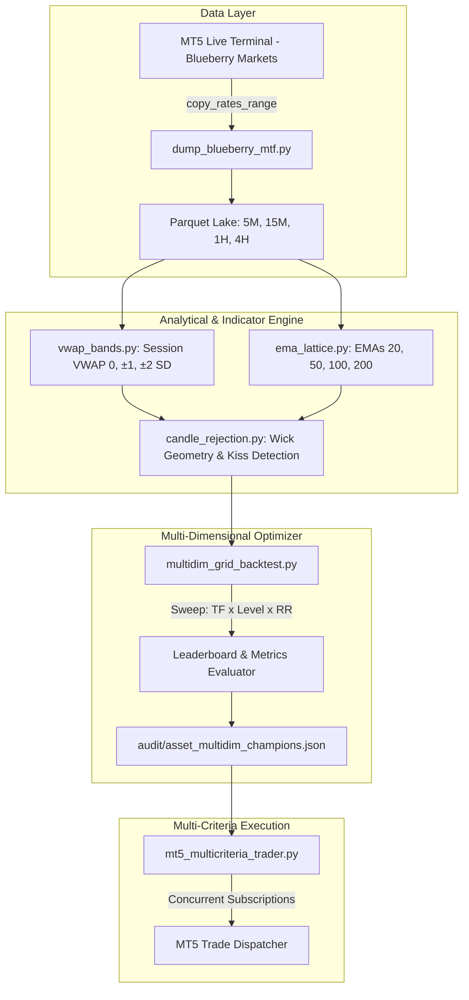

# Design Document: Multi-Dimensional VWAP Standard Deviation Bands & Multi-Timeframe EMA Candle Rejection System

- **Date**: 2026-11-19
- **Status**: Draft for Review
- **Author**: Antigravity Quantitative Trading Systems Team
- **Target Platform**: MetaTrader 5 (Blueberry Markets SVG Live) + Python

---

## 1. Intent & The Why

### 1.1 Problem Statement & Background
Institutional liquidity sweeps and mean-reversion reactions frequently manifest at distinct mathematical boundary lines in financial markets. As evidenced by real-world high-resolution order-flow charts (Coinglass BTC/USDT Perpetual), price behavior often displays aggressive "kiss and bounce" rejection candles (pinbars, hammers, shooting stars) when testing:
1. **Volume-Weighted Average Price (VWAP) Standard Deviation Bands**: Intraday institutional benchmark price and its volatility bands (-2, -1, 0, +1, +2 SD).
2. **Exponential Moving Averages (EMAs)**: Dynamic trend boundaries across multiple granularities (5M, 15M, 1H, 4H).

Historically, the local MT5 repository evaluated single-timeframe 1H and 4H EMA pullback setups in isolation. However, different assets exhibit vastly different structural liquidity behavior: an asset like NASDAQ (NAS100) or Gold (XAUUSD) might respect the 15M EMA 50 for trend continuation, while respecting the 1H VWAP -2 SD band for intraday liquidity sweeps.

### 1.2 System Intent
The goal of this system is to build an automated, multi-dimensional quantitative testing and execution framework in Python. For each asset across a designated watchlist, the system systematically sweeps across multiple dimensions (Timeframe $\times$ Indicator Type $\times$ Parameter $\times$ Risk-to-Reward Ratio) to identify the highest-expectancy candle rejection setups. This allows a single asset to be governed by a portfolio of validated, non-correlated entry criteria operating concurrently.

---

## 2. Goals, Non-Goals, and Anti-Goals

### 2.1 Goals
- **Multi-Timeframe Parquet Data Lake**: Ingest historical 5M, 15M, 1H, and 4H OHLCV data directly from MT5 (`tick_volume` and price) into high-performance parquet storage.
- **Session-Anchored VWAP Standard Deviation Engine**: Compute rolling and session-anchored intraday VWAP with standard deviation bands:
  - Upper: $+1.0\sigma$, $+2.0\sigma$
  - Mean: $0.0\sigma$ (VWAP)
  - Lower: $-1.0\sigma$, $-2.0\sigma$
- **Formalized Candle Rejection Geometry**: Implement an exact, mathematical pattern recognizer for "kiss and bounce" price action:
  - Penetration/Touch: The candle wick must touch or pierce the boundary level.
  - Closure: The candle body must close on the reactive side of the level (not through it).
  - Wick Ratio: The rejection wick must constitute a minimum percentage of the total candle range (e.g. $\ge 35\% - 50\%$).
- **Directional Trading Rule Matrix**:
  - **Bearish Regimes / Below Mean**:
    - Below 0 SD rejecting 0 SD from below $\rightarrow$ **SHORT** (Mean rejection).
    - Below -1 SD rejecting -1 SD from below $\rightarrow$ **SHORT** (Breakdown continuation).
    - Above/Sweeping -2 SD rejecting -2 SD from above $\rightarrow$ **Immediate LONG** (Lower boundary liquidity flush bounce).
  - **Bullish Regimes / Above Mean**:
    - Above 0 SD rejecting 0 SD from above $\rightarrow$ **LONG** (Mean support bounce).
    - Above +1 SD rejecting +1 SD from above $\rightarrow$ **LONG** (Breakout continuation).
    - Below/Sweeping +2 SD rejecting +2 SD from below $\rightarrow$ **Immediate SHORT** (Upper boundary liquidity flush rejection).
- **Multi-Timeframe EMA Sweep**: For 5M, 15M, 1H, 4H, test EMAs [20, 50, 100, 200] for touch-and-rejection candle bounces with varied R:R targets [1.5R, 2.0R, 2.5R, 3.0R, 3.5R, 4.0R, trailing].
- **Multi-Dimensional Grid Optimizer**: Simulate all combinations across the asset universe without lookahead bias (signal on close of bar $i$, execution at open of bar $i+1$).
- **Multi-Criteria Asset Registry**: Output a clean JSON/CSV matrix of winning setups per asset (`audit/asset_multidim_champions.json`), mapping multiple concurrent criteria per asset.

### 2.2 Non-Goals
- **No TradingView / Pine Script Development**: All modeling, backtesting, and execution logic is strictly implemented in Python and MT5 per user directive.
- **No Mutation of Existing Production Files**: Existing files (`mt5_alpha_trader_live.py`, `MT5_Backtest.py`) remain untouched during backtesting and optimization.
- **No Martingale or Unhedged Grid Averaging**: Every single signal maintains an explicit, calculated stop-loss and strict target risk ($5.00 fixed risk per trade).

### 2.3 Anti-Goals
- **Overfitting & Spurious Correlations**: Requiring a minimum trade count ($\ge 30$ trades) and positive expectancy across multiple market regimes before qualifying an asset-timeframe setup.
- **Lookahead Bias / Favorable Sequencing**: Position tracking must account for realistic intrabar paths (low-first on bullish bars, high-first on bearish bars) and realistic spreads/commissions.

---

## 3. Approaches Considered & Selected Architecture

### 3.1 Approaches Considered
- **Approach 1: Modular Multi-Dimensional Sweep Engine & Portfolio Matrix (SELECTED)**
  - Decoupled modules: MTF Data Lake Extractor, Indicator & Geometry Engine, Multi-Dimensional Grid Backtester, Multi-Criteria Portfolio Registry, and Live Multi-Setup Dispatcher.
  - *Pros*: Zero regression risk for existing code, clean testability, fast parallel execution, clear auditability.
- **Approach 2: Monolithic In-Place Refactoring of Existing MT5 Engine (REJECTED)**
  - Embedding all timeframes and indicators directly into `MT5_Backtest.py` and `mt5_alpha_trader_live.py`.
  - *Cons*: High blast radius, hard to debug, violates GRAVITAS stability invariants.

---

## 4. Technical Specification & Implementation Components

### 4.1 System Topology Diagram

---

### 4.2 Mathematical & Indicator Definitions

#### 4.2.1 Session-Anchored VWAP and Standard Deviation Bands
For each bar $t$ within session $S$ (anchored at 00:00 UTC daily for 24h assets, or session open for forex):
$$\text{Typical Price } P_t = \frac{\text{High}_t + \text{Low}_t + \text{Close}_t}{3}$$
$$\text{Cumulative Volume } V_t = \sum_{k \in S} \text{Vol}_k$$
$$\text{VWAP}_t = \frac{\sum_{k \in S} (P_k \times \text{Vol}_k)}{V_t}$$
$$\text{Variance}_t = \frac{\sum_{k \in S} \text{Vol}_k \times (P_k - \text{VWAP}_t)^2}{V_t}$$
$$\sigma_t = \sqrt{\text{Variance}_t}$$

Bands:
$$\text{Band}_{+2} = \text{VWAP}_t + 2 \sigma_t$$
$$\text{Band}_{+1} = \text{VWAP}_t + 1 \sigma_t$$
$$\text{Band}_{0} = \text{VWAP}_t$$
$$\text{Band}_{-1} = \text{VWAP}_t - 1 \sigma_t$$
$$\text{Band}_{-2} = \text{VWAP}_t - 2 \sigma_t$$

#### 4.2.2 Candle Rejection Geometry ("Kiss & Bounce")
Given confirmed candle $i$ with Open $O_i$, High $H_i$, Low $L_i$, Close $C_i$, Range $R_i = H_i - L_i$, and target boundary level $L$:
- Body Top $B_{top} = \max(O_i, C_i)$
- Body Bottom $B_{bot} = \min(O_i, C_i)$
- Upper Wick $W_{upper} = (H_i - B_{top}) / R_i$
- Lower Wick $W_{lower} = (B_{bot} - L_i) / R_i$

**Bullish Rejection (Support Kiss / Bounce)**:
1. **Touch / Kiss**: $L_i \le L \times (1 + \epsilon_{touch})$
2. **Reaction / Closure**: $C_i \ge L$ and $C_i \ge O_i$ (or close in top 50% of bar)
3. **Wick Proportion**: $W_{lower} \ge 0.35$ (lower wick $\ge 35\%$ of total range)

**Bearish Rejection (Resistance Kiss / Rejection)**:
1. **Touch / Kiss**: $H_i \ge L \times (1 - \epsilon_{touch})$
2. **Reaction / Closure**: $C_i \le L$ and $C_i \le O_i$ (or close in bottom 50% of bar)
3. **Wick Proportion**: $W_{upper} \ge 0.35$ (upper wick $\ge 35\%$ of total range)

---

### 4.3 Directional Setup Matrix

| Setup ID | Level Tested | Price Context | Trigger Condition | Trade Action | Invalidation / SL |
| :--- | :--- | :--- | :--- | :--- | :--- |
| `VWAP_0_SHORT` | VWAP ($0\sigma$) | Price below $0\sigma$ | Bearish Rejection Wick at $0\sigma$ | **SHORT** | $1.5 \times \text{ATR}$ above High |
| `VWAP_M1_SHORT` | Band $-1\sigma$ | Price below $-1\sigma$ | Bearish Rejection Wick at $-1\sigma$ | **SHORT** | $1.5 \times \text{ATR}$ above High |
| `VWAP_M2_LONG` | Band $-2\sigma$ | Price above/sweeping $-2\sigma$ | Bullish Rejection Wick at $-2\sigma$ | **LONG** | $1.5 \times \text{ATR}$ below Low |
| `VWAP_0_LONG` | VWAP ($0\sigma$) | Price above $0\sigma$ | Bullish Rejection Wick at $0\sigma$ | **LONG** | $1.5 \times \text{ATR}$ below Low |
| `VWAP_P1_LONG` | Band $+1\sigma$ | Price above $+1\sigma$ | Bullish Rejection Wick at $+1\sigma$ | **LONG** | $1.5 \times \text{ATR}$ below Low |
| `VWAP_P2_SHORT` | Band $+2\sigma$ | Price below/sweeping $+2\sigma$ | Bearish Rejection Wick at $+2\sigma$ | **SHORT** | $1.5 \times \text{ATR}$ above High |
| `EMA_MTF_LONG` | EMA $P$ (5M/15M/1H/4H) | Uptrend ($EMA_{slope} > 0$) | Bullish Rejection Wick kissing EMA | **LONG** | $1.5 \times \text{ATR}$ below Low |
| `EMA_MTF_SHORT` | EMA $P$ (5M/15M/1H/4H) | Downtrend ($EMA_{slope} < 0$) | Bearish Rejection Wick kissing EMA | **SHORT** | $1.5 \times \text{ATR}$ above High |

---

### 4.4 Risk & Position Management
- **Target Risk**: Fixed \$5.00 risk per trade.
- **Position Sizing Formula**:
  $$\text{Volume (lots)} = \text{clamp}\left(\frac{\$5.00}{\text{Risk Distance} \times \text{Tick Value}}, \text{min\_lot}, \text{max\_lot}\right)$$
- **Take-Profit Models Evaluated in Grid**:
  - Fixed R:R: `1.5R`, `2.0R`, `2.5R`, `3.0R`, `3.5R`, `4.0R`
  - Trailing R:R: `trail_0.5R`, `trail_1.0R`, `trail_1.5R` (with Breakeven lock at +1.0R)
- **Multi-Setup Cooldown**: 6 bars cooldown on the specific timeframe that fired the trade to prevent over-trading in chop.

---

## 5. Architectural Resolutions & Builder Decisions

### 5.1 Watchlist Scope & Data Synchronization (Answered from Project Context)
- **Watchlist**: The initial scope is focused on the **23 Champion Assets** defined in `OPTIMAL_ALPHA_BASKET` (Forex majors/minors, NAS100, US30, SPX500, XAUUSD, USWTI, BTCUSD, ETHUSD).
- **Data Horizon**: MT5 M5 and M15 data will be pulled for the maximum available broker depth (typically 6–12 months), and higher timeframes (1H, 4H) will be tested over both the synchronized common window and full historical depth.

### 5.2 Session Anchoring & VWAP Timeframe Resolution (Builder Call)
- **Session Anchor Timestamps**:
  - **Crypto (24/7)**: 00:00 UTC daily anchor.
  - **Forex & Indices (24/5)**: 00:00 Broker Server Time (Blueberry Markets rollover, matching institutional interbank day).
- **VWAP Calculation Resolution**:
  - Session VWAP is computed at the 5M granularity.
  - For **5M and 15M**, trades react directly to the intraday session VWAP bands.
  - For **1H and 4H**, VWAP uses a rolling multi-session or weekly anchor to prevent standard deviation collapse on low bar counts, while higher-timeframe models prioritize the multi-period EMA lattice.

### 5.3 Selection Objective Function & Filter Gates (Builder Call)
- **Ranking Metric**: Expected Value per trade ($EV = \text{Win Rate} \times \text{Avg Win} - \text{Loss Rate} \times \text{Avg Loss}$) combined with Total Net R.
- **Filter Cutoffs**: Minimum 25 trades, Profit Factor $\ge 1.30$, Max Drawdown $< 6.0R$.
- **Allocation Cap**: At most 1 champion setup per timeframe per indicator type per asset to eliminate redundant collinear triggers.

---

## 6. Multi-Criteria Concurrency & Risk Model (Approved by User)
- **Position Stacking**: Fully concurrent positions are enabled across timeframes with no artificial cap per asset.
- **Execution Isolation**: Each qualifying setup across 5M, 15M, 1H, and 4H operates as an independent trade ticket:
  - Distinct MT5 Magic Number / Comment (e.g. `fib_5m_ema`, `fib_15m_vwap`, `fib_1h_ema`, `fib_4h_ema`).
  - Independent \$5.00 fixed target risk per setup.
  - Independent stop-loss, take-profit, and trailing exit ratchets.
  - Independent timeframe cooldown (e.g., 6 bars on the specific timeframe that triggered).
- **Account Safety Floor**: Individual trades never risk more than \$5.00; broker-level global equity guardrails protect the master account from catastrophic drawdowns during extreme macro volatility.

---

## 7. Verification & Validation Plan
1. **Unit Verification**:
   - Verify VWAP calculation against known reference bars.
   - Verify candle rejection detection logic on historical test bars.
2. **Backtest Integrity**:
   - Verify zero lookahead (entry at $i+1$ Open).
   - Verify commission and spread accounting.
3. **Leaderboard Output**:
   - Generate summary CSV and JSON matrices with Win Rate, Profit Factor, Total Trades, Net R, and Max Drawdown.
